# Report Section: Part 8 — Matchups Tab (Weapon-to-Boss Assignment)

**Component Scope:** `frontend/src/tabs/MatchupsTab.jsx`, `frontend/src/tabs/matchups/ScoreGrid.jsx`, `frontend/src/tabs/matchups/ResultPanel.jsx`, `frontend/src/tabs/matchups/StepsView.jsx`, `frontend/src/tabs/matchups/MatrixView.jsx`, `frontend/src/tabs/matchups/Cell.jsx`, `frontend/src/tabs/matchups/normalizeAssign.js`, `frontend/src/tabs/matchups/matrixDiff.js`, `frontend/src/tabs/matchups/stepCaptions.js`, `frontend/src/tabs/matchups/validateScores.js`, `frontend/src/tabs/matchups/matchupsApi.js`.  
**Owner:** Shivam  
**Pair Partners:** Part 3 (Hungarian engine & `/api/assign` — Aditya), Part 6 (App shell, ScenarioPanel & StepPlayer — Vishesh).

---

## 1. Problem Statement and Mathematical Formulation

### 1.1 Decision Variables
Stage 3 determines the optimal pairing of $n$ weapons against $m$ bosses to optimize total raid combat score.  
Let binary decision variable $x_{ij} \in \{0, 1\}$ for weapon $i \in \{1, \dots, n\}$ and boss $j \in \{1, \dots, m\}$:
$$
x_{ij} = \begin{cases} 
1 & \text{if weapon } i \text{ is assigned to boss } j \\
0 & \text{otherwise}
\end{cases}
$$

### 1.2 Objective Function
Maximize the total combat damage score:
$$
\text{Maximize } Z = \sum_{i=1}^n \sum_{j=1}^m p_{ij} x_{ij}
$$
where $p_{ij} \ge 0$ is the damage matrix entry for weapon $i$ versus boss $j$. When transformed into the standard Hungarian minimization format:
$$
\text{Minimize } \sum_{i=1}^N \sum_{j=1}^N c_{ij} x_{ij}
$$
where $N = \max(n, m)$ and $c_{ij} = P_{\max} - p_{ij}$ with $P_{\max} = \max_{i,j} p_{ij}$.

### 1.3 Constraints and Assignment Structure
In an unbalanced setting ($n \ne m$), the real-world operational constraints require:
1. **Each weapon assigned to at most one boss:**
   $$
   \sum_{j=1}^m x_{ij} \le 1 \quad \forall i \in \{1, \dots, n\}
   $$
2. **Each boss engaged by at most one weapon:**
   $$
   \sum_{i=1}^n x_{ij} \le 1 \quad \forall j \in \{1, \dots, m\}
   $$
3. **Integrality / Binary Domain:**
   $$
   x_{ij} \in \{0, 1\} \quad \forall i, j
   $$

To solve this via the Hungarian method, the matrix is padded to dimension $N \times N$ with dummy rows or columns containing $0$ combat score. In this augmented system, every row and column has an exact one-to-one matching:
$$
\sum_{j=1}^N x_{ij} = 1 \quad \forall i \in \{1, \dots, N\}, \qquad \sum_{i=1}^N x_{ij} = 1 \quad \forall j \in \{1, \dots, N\}
$$

### 1.4 Unbalanced Matrix Handling
- **Case 1: More weapons than bosses ($n > m$, e.g., 5 weapons vs 4 bosses):**
  Padded by adding $n - m$ dummy columns with initial scores $0$ ($c_{ij} = 0$ in minimization). Any real weapon matched to a dummy column contributes $0$ points and is labeled **Benched**. In the API envelope, it is excluded from `answer.pairs` and listed in `answer.unassigned.rows` (1-based).
- **Case 2: More bosses than weapons ($m > n$, e.g., 4 weapons vs 5 bosses):**
  Padded by adding $m - n$ dummy rows with initial scores $0$. Any boss matched to a dummy row represents a boss fought with no dedicated weapon and is labeled **Unassigned / No Weapon**. In the API envelope, it is listed in `answer.unassigned.cols`.

---

## 2. Algorithm Walk-Through

### 2.1 Default 5×5 Scenario (Section 3.3)
Initial Damage Matrix:
```
       B1   B2   B3   B4   B5
W1 [  82   64   97   43   96 ]
W2 [  48   40   61   59   50 ]
W3 [  83   97   81   50   61 ]
W4 [  95   78   72   60   84 ]
W5 [  69   79   54   96   66 ]
```

1. **Conversion to Minimization ($c_{ij} = P_{\max} - p_{ij}$ with $P_{\max} = 97$):**
   ```
   W1: [ 15, 33,  0, 54,  1 ]
   W2: [ 49, 57, 36, 38, 47 ]
   W3: [ 14,  0, 16, 47, 36 ]
   W4: [  2, 19, 25, 37, 13 ]
   W5: [ 28, 18, 43,  1, 31 ]
   ```
2. **Row Reduction (subtract row minimums: 0, 36, 0, 2, 1):**
   ```
   W1: [ 15, 33,  0, 54,  1 ]
   W2: [ 13, 21,  0,  2, 11 ]
   W3: [ 14,  0, 16, 47, 36 ]
   W4: [  0, 17, 23, 35, 11 ]
   W5: [ 27, 17, 42,  0, 30 ]
   ```
3. **Column Reduction (subtract column minimums: 0, 0, 0, 0, 1):**
   ```
   W1: [ 15, 33,  0, 54,  0 ]
   W2: [ 13, 21,  0,  2, 10 ]
   W3: [ 14,  0, 16, 47, 35 ]
   W4: [  0, 17, 23, 35, 10 ]
   W5: [ 27, 17, 42,  0, 29 ]
   ```
4. **Minimum Line Covering:**
   5 lines cover all zeros ($k = 5 = n$). Since line count equals matrix dimension, no adjustment step is needed.
5. **Optimal Assignment:**
   - Weapon 1 $\rightarrow$ Boss 5 (Damage: 96)
   - Weapon 2 $\rightarrow$ Boss 3 (Damage: 61)
   - Weapon 3 $\rightarrow$ Boss 2 (Damage: 97)
   - Weapon 4 $\rightarrow$ Boss 1 (Damage: 95)
   - Weapon 5 $\rightarrow$ Boss 4 (Damage: 96)
   - **Total Score:** $96 + 61 + 97 + 95 + 96 = \mathbf{445}$  
   - **Greedy Baseline Comparison:** Greedy selection sequentially takes the best available boss per weapon (in order): W1 $\rightarrow$ B3 (97), W2 $\rightarrow$ B4 (59), W3 $\rightarrow$ B2 (97), W4 $\rightarrow$ B1 (95), W5 $\rightarrow$ B5 (66), yielding **414**. The Hungarian optimal assignment yields $\mathbf{445}$, delivering a **+7.5% score gain**.

### 2.2 Adjust Case (Cover & Matrix Adjustment)
1. **Part 3 Official 4×4 Maximize Case (`assign_adjust.json`):**  
   Input scores: `[[26, 19, 10, 12], [28, 34, 13, 22], [13, 37, 19, 22], [12, 40, 10, 37]]`.  
   Initial cover requires 3 lines ($3 < 4$). Adjustment adds/subtracts $\delta = 2$, yielding optimal score **116**.
2. **Demo Plan Section 3.3 4×4 Minimize Case (`assign_adjust_min.json`):**  
   Cost matrix: `[[6, 6, 6, 3], [7, 7, 8, 9], [7, 9, 2, 9], [5, 7, 4, 5]]`.  
   Cover needs 3 lines ($3 < 4$). Adjustment with $\delta = 1$ leads to optimal matching with cost **17** (pairs: W1-B4 (3), W2-B2 (7), W3-B3 (2), W4-B1 (5)).

---

## 3. UI Architecture and Layout Sketch

### 3.1 Result-first, two-column layout
The tab opens with the grid only (nothing is solved). The result appears when the viewer presses **Solve**; **Reset** returns the grid to the default and clears any result, and the Reset button always stays in the toolbar; the step replay is opened on demand with **View Steps** and closed with **Hide Steps**. On wide screens (`lg` and up) the replay opens in a right-hand column next to the grid and the result, so Back / Next / Play never scroll out of view. Below that width the columns stack, the replay opens directly under the result (next to the button that opened it), and the page scrolls to it so Next is on screen.

```
+--------------------------------------------------------------------------------+
| SHADOW CITADEL  Stage 3: Weapon-to-Boss Matchups                  * Hungarian   |
+-----------------------------------+--------------------------------------------+
| LEFT COLUMN                       | RIGHT COLUMN (only while steps are open)   |
| [Preset v] [x] Maximize Rows Cols | Step-by-Step Replay (4 steps)  [Hide Steps]|
| [Reset]                           | [|<] [Back] [Play] [Next] [>|]  Step 1 of 4|
|                                   | Speed: Fast Normal Slow   800 ms           |
| score grid W1..W5 x B1..B5        | "Scores were turned into costs first: ..." |
| (chosen = green ring + tick)      | caption + phase chip                       |
| [ SOLVE ]                         | Row Minimums: W1: 0  W2: 36  W3: 0 ...     |
|                                   | step matrix (changed = orange ring,        |
| demo-data banner (edited grid)    |              zero = blue, covered = amber/ |
| error banner + Retry              |              cyan, intersection = purple)  |
|                                   | legend (only entries that apply)           |
| OPTIMAL COMBAT ASSIGNMENT   445   |                                            |
| W1 -> Boss 5 +96    W2 -> Boss 3 +61 ...                                        |
| greedy comparison        [Hide Steps]                                           |
+-----------------------------------+--------------------------------------------+
```

### 3.2 Visual tokens and colour legend
Colours come from the `theme.css` tokens (`--panel`, `--panel-border`, `--accent`, `--ok`, `--warn`) plus Tailwind utilities (see `docs/decisions.md`, item 11).
- **Green ring and tick (`--ok`):** the chosen pair. The tick means the meaning does not depend on colour alone.
- **Orange ring:** a cell that changed since the previous step.
- **Blue "ZERO" cell:** a zero in the current matrix.
- **Amber / cyan / purple (cover and adjust steps):** covered row, covered column, and a cell covered by both (the `+δ` cells).
- **Hatched cell and label "Dummy":** the padding row or column of an unbalanced grid. Shown in the legend only when the grid has padding.
- **Red outline:** an invalid score cell (blank, decimal, negative or above 999); Solve is disabled.

### 3.3 The two opening steps of the replay
The replay starts with two steps that come before the algorithm's own steps:
1. **Original matrix:** the scores exactly as entered (no padding, no highlights), so the viewer sees the starting point.
2. **Convert:** for maximize mode, every score is subtracted from the largest score (for the default grid P_max = 97, so 97 − 82 = 15 in the first cell). The biggest damage becomes 0, so maximizing damage turns into minimizing cost. In minimize mode the caption says the scores are already costs and are used as they are. For an unbalanced grid the caption adds that a Dummy row or column of zeros pads the grid to a square.

Step 1 is built in `StepsView.jsx` from the entered scores; step 2 is the backend's `convert` step with a plain-language caption. Neither step shows orange "changed" rings, because every cell changes. The step counter therefore reads 6 steps for the default grid (original, convert, row, column, cover, final) and 8 for the minimize 4×4 case.

### 3.4 Cross-part integration
1. **Part 6 (shell and `StepPlayer`):** the replay uses the shared `components/StepPlayer.jsx` with `showScrubber={false}` and `showNote={false}`; the Matchups tab does not edit that file.
2. **Part 3 (`/api/assign`):** `normalizeAssign.js` is the only place that knows the backend format. The contract is **1-based** (`pairs`, `covered_rows`, `covered_cols`, `selected`, `dummy_*`, `unassigned`); the adapter converts everything to 0-based for the UI.
3. **API client:** `matchupsApi.js` only calls `api.assign(scores, maximize)`. All fixture routing lives in `frontend/src/api.js` (see `docs/decisions.md`, item 12).

---

## 4. Fixture-Mode Limitations and Data Flow

### 4.1 Fixture Mode Offline Behavior
- When running offline (`VITE_USE_FIXTURES=true`), the frontend relies on canned mock traces (`assign.json`, `assign_adjust.json`, `assign_adjust_min.json`, `assign_unbalanced.json`, `assign_4x5.json`).
- If a user modifies cell scores outside of recognized presets or unchecks the Maximize toggle on the default grid, fixture mode cannot compute arbitrary live reductions.
- The UI detects score deviations and renders the demo data mode banner:
  > **Demo data mode:** edited scores are only solved once the live API is connected.
- While the banner is shown, the result panel, the step replay and the green tick marks on the grid are all hidden, so an old answer is never shown next to edited numbers.
- Connecting to the live FastAPI backend (`VITE_USE_FIXTURES=false`) sends a `POST /api/assign` request to execute full real-time Hungarian reductions.

### 4.2 Score flow between the Scenario panel and the Matchups tab
- `MatchupsTab` reads `scenario.weapon_boss_scores` as its starting grid. If that value changes, the grid reloads, the Maximize box is set to checked, and any old result is cleared until Solve is pressed.
- `ScenarioPanel` has **no editor for `weapon_boss_scores` today**, so in the running app this path is only exercised by a unit test ("accepts shared scores from scenario prop"), not by a user action.
- Edits made in the Matchups grid stay inside the tab. `App.jsx` renders `<ActiveComponent scenario={scenario} />` and passes no `onScoresChange`. The tab already calls `onScoresChange` whenever one is supplied, so two-way sync needs a one-line change in `App.jsx` and a score editor in `ScenarioPanel`. Both belong to Part 6 and have **not yet been agreed**; this is listed as an open item in the pull request.

---

## 5. Verification and Test Results

### 5.1 Test suite breakdown
Tests for this part are in [`frontend/src/__tests__/MatchupsTab.test.jsx`](../../frontend/src/__tests__/MatchupsTab.test.jsx): **33 tests, 23 component tests and 10 utility tests**.

| Group | Tests | What it checks |
|---|---|---|
| Nothing solved on open | 2 | The tab opens with the grid, a hint, no result and no ticks; Reset clears a result, stays visible, and the result only returns when Solve is pressed. |
| Solve, result and errors | 4 | Default grid shows 445 and exactly five chosen cells; error banner and Retry; any edit clears the old result; Enter solves. |
| Step replay | 4 | Open and navigate the replay; the adjust phase with δ = 2 (Part 3 maximize case, step 6); row minimums 0, 36, 0, 2, 1 with changed cells highlighted (step 3); the final step shows the optimal zeros. |
| Presets and unbalanced grids | 3 | 5×4 gives 385 with Weapon 2 Benched; 4×5 gives 349 with Boss 4 Unassigned; Minimize 4×4 gives cost 17. |
| Demo-data banner | 2 | Banner shows and the result is hidden when a score is edited or Maximize is switched off on the default grid. |
| Shared scores | 1 | New `scenario.weapon_boss_scores` reloads the grid. |
| Opening steps and page structure | 5 | Step 1 is the original matrix and step 2 shows P_max = 97 with the converted cells; the 5×4 convert step explains the Dummy column; minimize mode says the scores are used as they are; no second `<h1>` and no hidden raw-total element; Maximize is re-checked when new scenario scores arrive. |
| Fixture-mode guards | 2 | No green ticks stay on an edited grid; the Dummy legend entry appears only when the grid has padding. |
| Utilities | 10 | `matrixDiff` (2), `computeGreedyScore` (2), `normalizeAssign` 1-based to 0-based conversion including unassigned rows and 4×5 (3), `validateScores` including decimals (3). |

- Whole frontend suite: **6 test files, 70 tests, all passing**. `frontend/src/__tests__/api.test.js` gained one test for the 4×4 and 4×5 fixture routing.
- Backend: `assign_4x5.json` and `assign_adjust_min.json` are registered in the contract tests (`test_contract_shapes.py`, `test_data_integrity.py`); the backend suite passes on the current main (124 passed, 7 expected-pending tests belonging to other parts).
- `vite build` completes without errors.

---

## 6. Screenshots

Captured from the running app (`npm run dev`, fixture mode) in Chromium: desktop 1440 × 1000 and phone 390 × 844. Files are in `docs/report/screenshots/`.

**Figure 8.1: opening view.** The default grid, unsolved, with a hint, Solve and Reset.
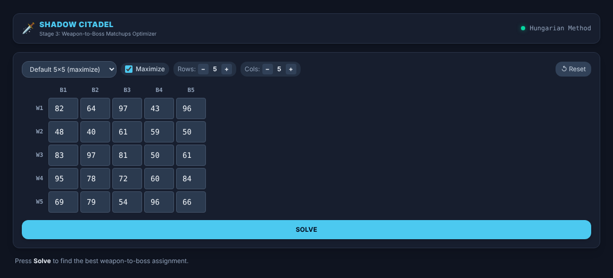

**Figure 8.2: default result after Solve.** The default 5×5 grid solved to a total of 445, with the five chosen cells ringed and ticked.
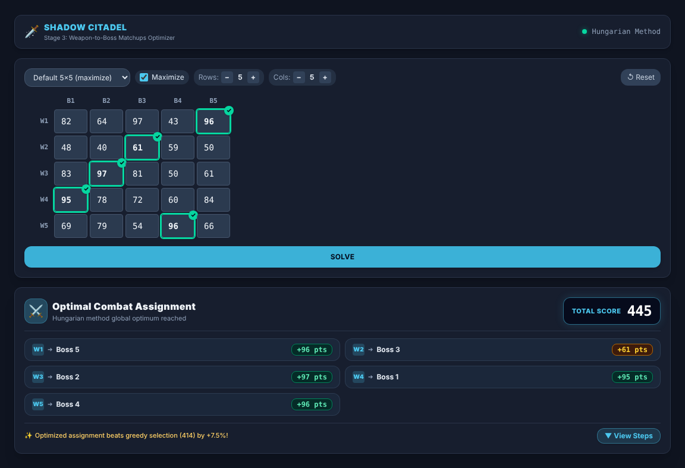

**Figure 8.3: replay, step 1.** The original matrix, exactly as entered.
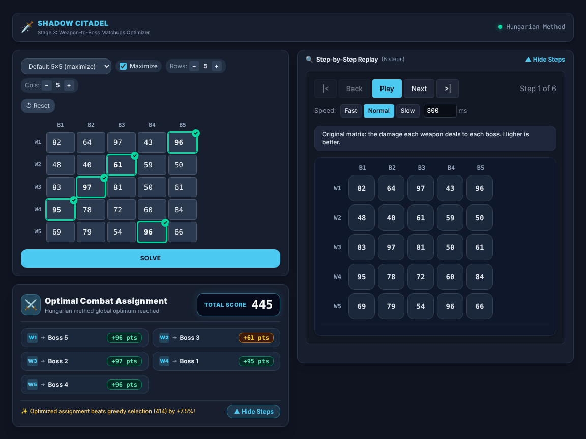

**Figure 8.4: replay, step 2 (convert).** Each score is subtracted from P_max = 97, so the best damage becomes 0.
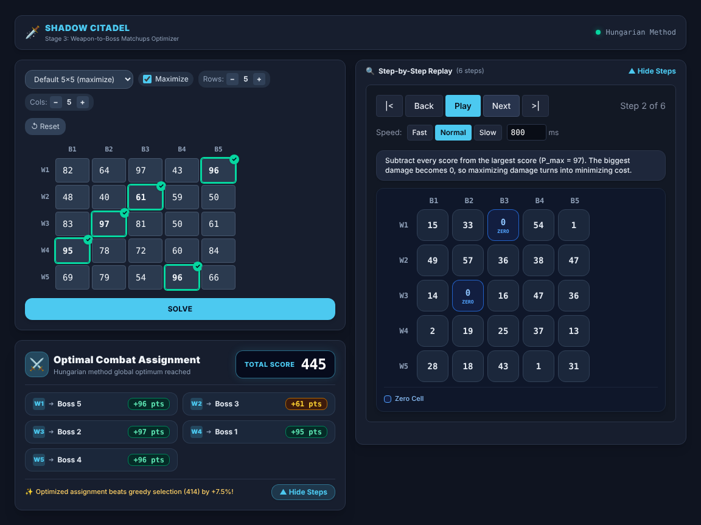

**Figure 8.5: replay, row reduction (step 3).** The minimums are 0, 36, 0, 2, 1, and the changed cells carry an orange ring.
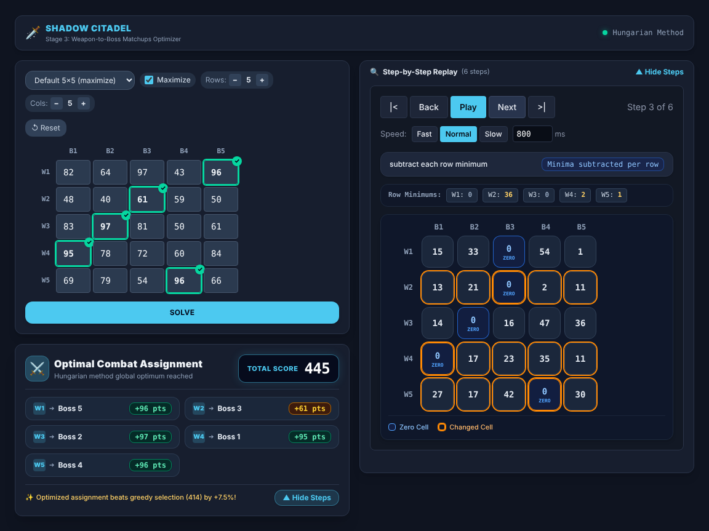

**Figure 8.6: cover and adjust (minimize 4×4).** The adjust step with δ = 1: uncovered cells lose 1, line intersections gain 1, total cost 17.
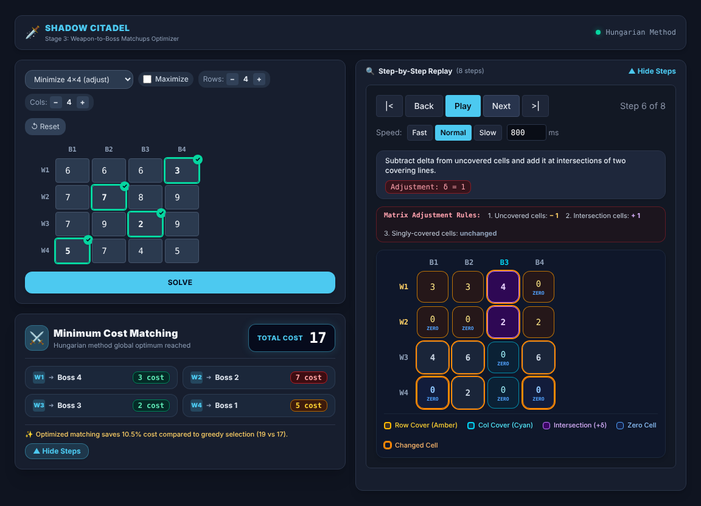

**Figure 8.7: unbalanced 5×4.** Weapon 2 is Benched (paired with the dummy column); total 385.
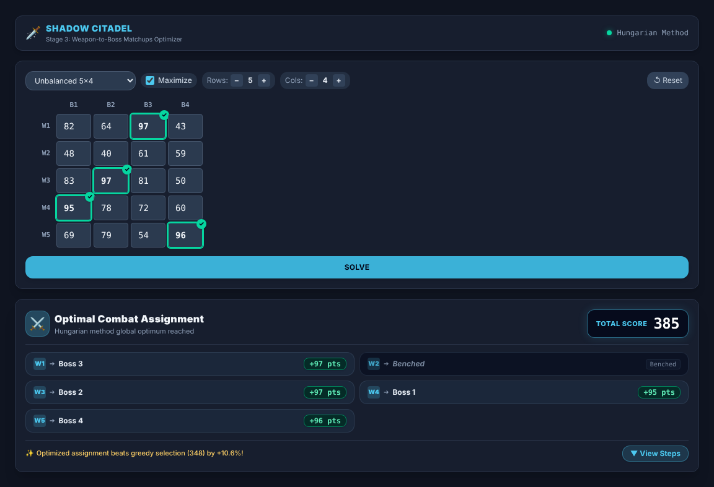

**Figure 8.8: more bosses than weapons (4×5).** Boss 4 has no weapon; total 349.
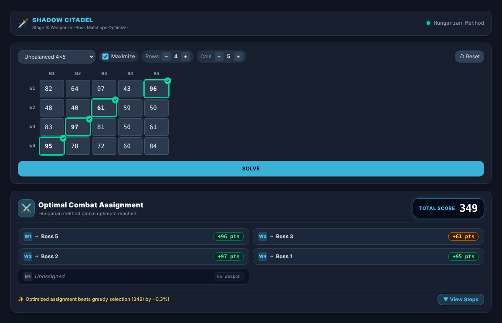

**Figure 8.9: invalid input.** A blank cell is outlined, a message explains the rule, and Solve is disabled.
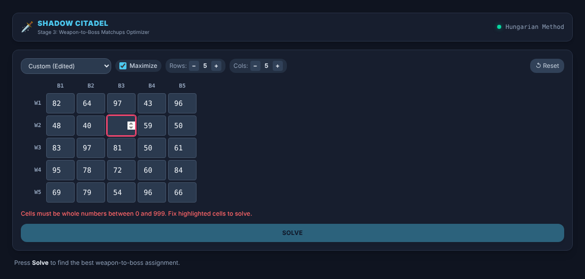

**Figure 8.10: fixture-mode limitation.** After a score is edited, the demo-data banner appears and the old result, replay and ticks are hidden.
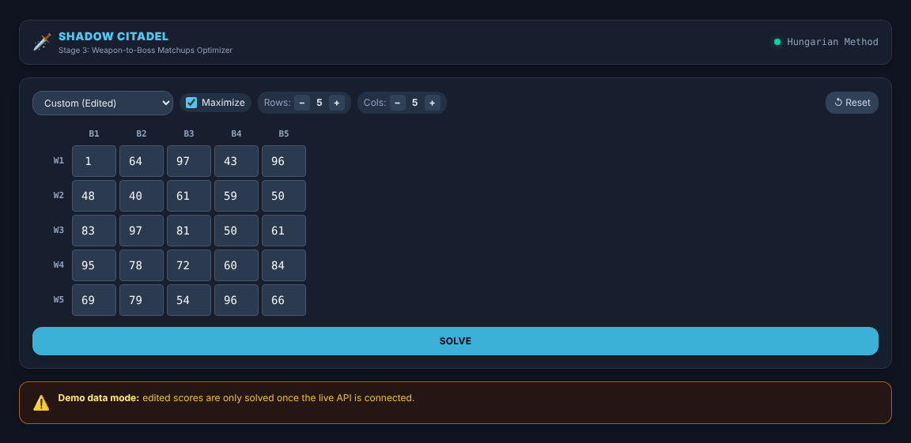

**Figure 8.11: phone width.** The replay opens directly under the result, the page scrolls to it, and its buttons wrap; wide matrices scroll sideways.
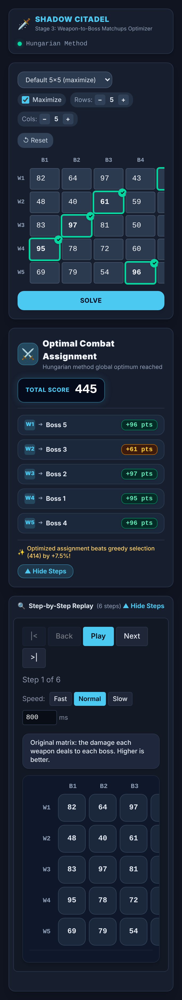

---

## 7. Integration Guide & Final Checklist

### 7.1 Explanation of Adjust Fixture Values (116 vs 17)
- **Demo Plan Section 3.3 Expectation (17):** The project plan introduced a 4×4 minimization example (`[[6,6,6,3],[7,7,8,9],[7,9,2,9],[5,7,4,5]]`) whose optimal cost is **17**.
- **Part 3 Backend Benchmark (116):** Part 3's fixture `assign_adjust.json` uses a 4×4 *maximization* benchmark (`[[26,19,10,12],[28,34,13,22],[13,37,19,22],[12,40,10,37]]`) to specifically exercise matrix adjustment ($\delta = 2$) in maximization form, which produces score **116**.
- **Resolution:** Part 8 supports both cases via dedicated presets: `Part 3 Adjust 4×4 (max)` (score 116) and `Minimize 4×4 (adjust)` (cost 17). Both replay full Hungarian reduction traces with contract-checked fixtures.

### 7.2 Values Part 10 should expect (Summary & Experiments; to be confirmed with Part 10 in the pull request)
- Stage 3 Combat Score: **445** (greedy baseline 414, gain +7.5%).
- Unbalanced 5×4 Combat Score: **385** (W2 benched).
- End-to-end raid pipeline total: **562** ($445 \text{ combat} + 117 \text{ crafting}$).
