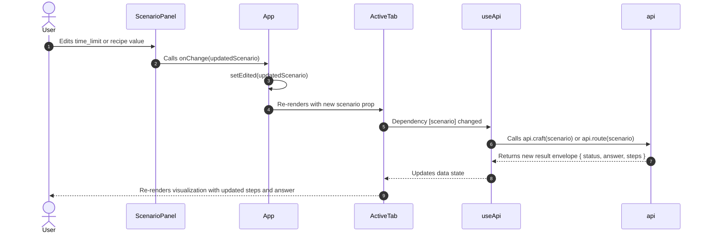

# Research Document 2: Component Architecture and Data Flow

## 1. System Architecture Overview

The frontend architecture follows a centralized state, reactive prop-drilling pattern designed for modularity and isolation between tabs.

```mermaid
graph TD
    App[App Component] --> Header[Header & Data Source Banner]
    App --> TabNav[Tab Navigation / Tabs Bar]
    App --> RootStatus[Global Status Container]
    RootStatus --> ScenarioPanel[ScenarioPanel: Scenario Editor]
    RootStatus --> ActiveTab[Active Tab Component: MapTab | MatchupsTab | LoadoutTab | SummaryTab]
    
    ActiveTab --> TabStatus[Tab Status Component]
    TabStatus --> StepPlayer[Reusable StepPlayer]
    StepPlayer --> TabCustomView[Tab-Specific Step Visualizer]
```

---

## 2. Component Hierarchy and Responsibilities

### 2.1 `App.jsx` (Application Shell)
- **Role:** Root orchestrator.
- **State Managed:**
  - `active`: ID of the currently selected tab (`"map"`, `"matchups"`, `"loadout"`, `"summary"`).
  - `loaded`: Scenario object fetched on mount via `api.scenario()`.
  - `edited`: Scenario object modified by the user in `ScenarioPanel` (or `null` if untouched).
  - Derived scenario: `const scenario = edited ?? loaded`.
- **Key Responsibilities:**
  - Render accessible tablist navigation.
  - Render data source indicator with tooltip of fixture limitations.
  - Pass the effective `scenario` to `ScenarioPanel` and the active tab component.
  - Provide a clean container with consistent layout, header, and margins.

### 2.2 `ScenarioPanel.jsx` (Global Scenario Editor)
- **Role:** Interactive inspector and editor for the active scenario.
- **Props:**
  - `scenario`: The current effective scenario object.
  - `onChange(nextScenario)`: Callback invoked when the user modifies any scenario parameter.
  - `onReset()`: Callback to discard edits and revert to the default scenario.
- **Key Responsibilities:**
  - Provide collapsible accordion panel.
  - Display and allow direct editing of:
    - Raid time limit (`total_time`, default 120 min).
    - Resource and inventory constraints (`limits`: weight, stamina, survival_min, slots).
    - Item recipe attributes (`recipes`: score, time, weight, stamina, survival).
  - Trigger immediate or debounced updates back up to `App`.

### 2.3 `Status.jsx` (Envelope Status & Error Boundary)
- **Role:** Universal status handler for loading, network errors, and solver feasibility.
- **Props:**
  - `loading`: Boolean indicating network in-flight.
  - `error`: Error object (network failure, HTTP 422, 501, 500).
  - `result`: The API envelope `{ status, answer, steps }`.
  - `children`: Content to render when not loading/erroring.
- **Key Responsibilities:**
  - Render loading indicator (`Loading...` or spinner).
  - Render error message with accessible alert role (`role="alert"`).
  - Render infeasible/unbounded warnings (`role="status"`) using `answer.message` while still rendering child components (so users can inspect the steps that led to infeasibility).

### 2.4 `StepPlayer.jsx` (Universal Replay Engine)
- **Role:** Headless/composite player providing playback controls over any `steps` array.
- **Props:**
  - `steps`: Array of step objects (B&B nodes, Hungarian phases, Simplex tableaux, etc.).
  - `children`: Render prop function `(currentStep, currentIndex) => ReactNode`.
  - `initialSpeedMs`: Default playback speed in milliseconds (default 800ms).
- **Key Responsibilities:**
  - Manage active step index (`index` state).
  - Manage timer-based playback (`playing` state).
  - Provide complete controls: First, Previous, Play/Pause, Next, Last, and Scrubber slider.
  - Expose step counter and optional notes.

### 2.5 `api.js` & `useApi.js` (Data Fetching & Reactive Hook)
- **Role:** Abstraction over API endpoints with automatic fixture fallback and async lifecycle handling.
- **Responsibilities:**
  - `useApi(fetcher, deps)`: Hook managing `{ loading, error, data }` state, with cancellation cleanup on component unmount or dependency change.
  - Deep cloning of fixtures to guarantee immutability.
  - Transparent switching between live HTTP requests and canned fixtures via `VITE_USE_FIXTURES`.

---

## 3. Data Flow and Reactivity Model

The diagram below illustrates how a scenario edit propagates across the entire application and updates the active solver tab:



### 3.1 Immutability and State Cloning
To avoid unintended side-effects:
1. `ScenarioPanel` makes defensive copies of nested scenario fields when editing (`recipes`, `limits`).
2. `api.js` runs `structuredClone(fixture)` on all canned responses.
3. Tabs treat `scenario` as read-only.

### 3.2 Fixture Mode vs Live Mode Behavior
- **In Live Mode (`VITE_USE_FIXTURES=false`):**
  Changing a slider or input immediately triggers a backend calculation, producing fresh results and steps in real time.
- **In Fixture Mode (`VITE_USE_FIXTURES=true`):**
  Inputs can still be edited in `ScenarioPanel`, demonstrating the UI responsiveness. In fixture mode, `api.craft` intelligently routes to:
  - `craft_infeasible.json` for `time_limit < 42`
  - `craft_42.json` for `time_limit == 42`
  - `craft.json` / `craft_twophase.json` for `time_limit >= 43`
