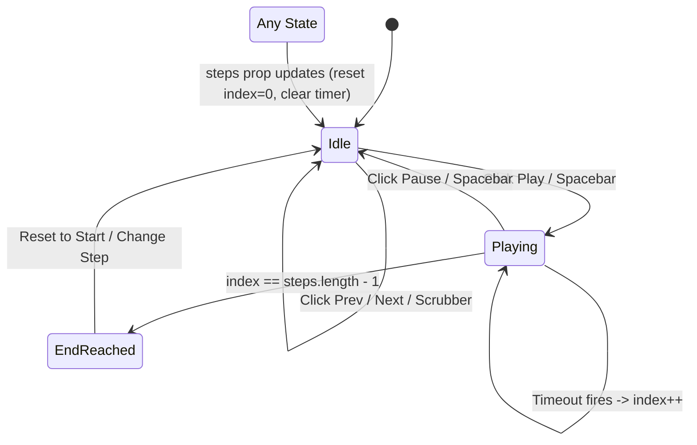

# Research Document 4: Reusable Step Player Specification

## 1. Overview and Core Philosophy

The `StepPlayer` is the centerpiece interactive component of the application. It provides step-by-step replay functionality across every optimization solver in the project.

The plan states in `docs/parts.md`:
> *"Any tab can plug in a step list and get a working player."*

To achieve true universal reusability, `StepPlayer` uses the **render-prop pattern**, managing all playback state internally while allowing each tab to render its own domain-specific visualization (maps, matrices, or simplex tableaux).

---

## 2. Multi-Tab Consumer Requirements

Each tab feeds a distinct step schema into `StepPlayer`:

### 2.1 Map Tab (Part 7) — Branch-and-Bound / Hull
- **Hull:** Steps emit point operations (`action: "push" | "pop" | "skip"`, `stack: ["Base", "L4", ...]`).
- **Route (TSP):** Steps emit branch-and-bound nodes (23 nodes in `fixtures/route.json`):
  ```json
  {
    "node": 3,
    "parent": 2,
    "forbidden_arcs": [["Base","C7"], ["Base","C5"]],
    "branched_arc": ["Base","C5"],
    "cost": 70,
    "subtours": [["Base","C4","C5","C7"], ["C1","C2"], ["C3","C6"]],
    "status": "branch",
    "incumbent": null,
    "note": "branch on arcs of the smallest subtour: C1->C2, C2->C1"
  }
  ```
- **Tab Needs:** Quick scrubbing across all 23 nodes, ability to jump to root (node 1) or optimal node (node 4).

### 2.2 Matchups Tab (Part 8) — Hungarian Method Phases
- **Hungarian steps:** Emits phases (`convert` -> `row_reduce` -> `col_reduce` -> `cover` -> `adjust` -> `final`):
  ```json
  {
    "phase": "cover",
    "matrix": [[...]],
    "covered_rows": [1, 3],
    "covered_cols": [2],
    "dummy_rows": [],
    "dummy_cols": [],
    "note": "covered with 3 lines; lines < n so adjust next"
  }
  ```
- **Tab Needs:** Clear phase note banner, forward/back stepping to study matrix transformations.

### 2.3 Loadout Tab (Part 9) — Simplex Tableaux
- **Simplex steps:** Emits full tableau iterations (Big-M or Two-Phase):
  ```json
  {
    "iteration": 2,
    "phase": "bigm",
    "columns": ["x1","x2","x3","x4","s1","s2","s3","e4","a4","a5"],
    "basis": ["x1","x3","x4","s2","s3"],
    "tableau": [[...]],
    "entering": "x3",
    "leaving": "s1",
    "pivot": [3, 0],
    "z": 112,
    "note": "x3 enters, s1 leaves"
  }
  ```
- **Tab Needs:** Ability to step pivot-by-pivot, see iteration number, and inspect the entering/leaving variable note.

---

## 3. Component Interface & API Design

### 3.1 Props Interface
```typescript
interface StepPlayerProps<T = any> {
  steps: T[];
  children?: (currentStep: T, currentIndex: number) => React.ReactNode;
  initialSpeedMs?: number; // default: 800ms
  showScrubber?: boolean;  // default: true
  showNote?: boolean;      // default: true
  className?: string;
}
```

### 3.2 Render Prop Usage
```jsx
<StepPlayer steps={data.steps}>
  {(step, index) => (
    <TableauView tableau={step.tableau} pivot={step.pivot} note={step.note} />
  )}
</StepPlayer>
```

---

## 4. Control Set and UX Specification

```
+-------------------------------------------------------------------------------+
| [|< First]  [< Prev]  [ ▶ Play / ⏸ Pause ]  [Next >]  [Last >|]               |
|                                                                               |
| Scrubber:  o========================●==========================o              |
|            Step 4 of 23                                                       |
|                                                                               |
| Speed: [ Slow (1200ms) | Normal (800ms) | Fast (400ms) ]                      |
| Note: "branch on arcs of the smallest subtour: C1->C2, C2->C1"                |
+-------------------------------------------------------------------------------+
| { Tab-specific children visualization rendered here }                         |
+-------------------------------------------------------------------------------+
```

### 4.1 Comprehensive Controls
1. **Jump to Start (`|< First`):** Sets `index = 0`. Disabled when `index === 0`.
2. **Step Backward (`< Prev`):** Decrements `index` by 1. Disabled when `index === 0`.
3. **Play / Pause (`▶ / ⏸`):** Toggles automatic step advancement using a timeout loop. Automatically pauses when reaching the final step (`index === steps.length - 1`).
4. **Step Forward (`Next >`):** Increments `index` by 1. Disabled when `index === last`.
5. **Jump to End (`Last >|`):** Sets `index = steps.length - 1`. Disabled when `index === last`.
6. **Timeline Scrubber:** Range slider `<input type="range" min={0} max={last} value={index}>` allowing instant jump to any point in the sequence.
7. **Speed Adjustment:** Pre-set toggles (Fast: 300ms, Normal: 800ms, Slow: 1500ms) plus custom numeric input.
8. **Step Banner / Note:** Displays `step.note` or `step.phase` when available.

### 4.2 Keyboard Navigation
When the player container or its controls are focused:
- **Left Arrow:** Decrement step.
- **Right Arrow:** Increment step.
- **Home:** Jump to first step.
- **End:** Jump to last step.
- **Space:** Toggle play/pause (with `e.preventDefault()` to prevent page scrolling).

---

## 5. State Machine and Lifecycle Safety



### 5.1 Timer Safety
- The timer must always be cleaned up in the `useEffect` cleanup return:
  ```javascript
  useEffect(() => {
    if (!playing) return;
    if (index >= last) {
      setPlaying(false);
      return;
    }
    const timer = setTimeout(() => {
      setIndex((i) => Math.min(i + 1, last));
    }, speedMs);
    return () => clearTimeout(timer);
  }, [playing, index, last, speedMs]);
  ```
- If the `steps` prop changes (e.g. user selects a different solver method or scenario), reset state immediately:
  ```javascript
  useEffect(() => {
    setIndex(0);
    setPlaying(false);
  }, [steps]);
  ```
