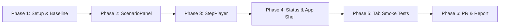

# Research Document 7: Step-by-Step Implementation Plan

## 1. Roadmap Overview

This execution plan provides a phased, risk-managed progression to complete **Part 6 (App shell and shared components)** in full compliance with the repository rules and project requirements.

---

## 2. Phase Breakdown

### Phase 1: Environment & Baseline Verification
- **Goal:** Ensure test environment and toolchains run cleanly without baseline regressions.
- **Tasks:**
  1. Ensure `node` and `npm` are available. Run `npm install` inside `frontend/`.
  2. Commit `frontend/package-lock.json` (as noted in `docs/changes-v2.md`).
  3. Run baseline frontend tests (`npm test` in `frontend/`) to confirm 100% pass on existing stubs.
- **Verification Gate:** All 4 existing test suites pass.

---

### Phase 2: ScenarioPanel Implementation (`components/ScenarioPanel.jsx`)
- **Goal:** Transform the static placeholder into a responsive, editable scenario configuration panel.
- **Tasks:**
  1. Build input controls for:
     - Raid time limit (`total_time`).
     - Resource limits: `weight` (40), `stamina` (90), `survival_min` (30), `slots` (14).
     - Recipe matrix: 4 consumable items (Health potion, Stamina potion, Damage elixir, Shield scroll) with 5 numeric attributes each (`score`, `time`, `weight`, `stamina`, `survival`).
  2. Implement safe immutability helpers for state updates.
  3. Implement "Reset to Defaults" button using the baseline scenario snapshot.
  4. Write comprehensive tests in `frontend/src/__tests__/ScenarioPanel.test.jsx`:
     - Test initial field rendering.
     - Test input changes calling `onChange` with updated values.
     - Test reset button restoring defaults.
     - Test that non-edited fields (`nodes`, `loot`, `weapon_boss_scores`) are preserved.
- **Verification Gate:** `ScenarioPanel.test.jsx` passes completely.

---

### Phase 3: StepPlayer Enhancement (`components/StepPlayer.jsx`)
- **Goal:** Build the universal playback engine supporting B&B nodes, Hungarian matrix phases, and Simplex tableaux.
- **Tasks:**
  1. Add boundary jumping: First (`|<`) and Last (`>|`) buttons.
  2. Add timeline scrubber `<input type="range">` for instant seeking.
  3. Add playback speed presets (Fast: 300ms, Normal: 800ms, Slow: 1500ms) alongside custom ms input.
  4. Add step metadata banner to display `step.note`, `step.phase`, or `step.status`.
  5. Add keyboard shortcuts (ArrowLeft: back, ArrowRight: next, Space: play/pause).
  6. Add safety checks for empty steps (`[]`), single step, and dynamic steps prop updates.
  7. Expand `frontend/src/__tests__/StepPlayer.test.jsx`:
     - Test scrubber interaction.
     - Test First / Last buttons.
     - Test fake timer auto-play with pause at final step.
     - Test dynamic prop reset.
- **Verification Gate:** `StepPlayer.test.jsx` passes completely.

---

### Phase 4: Status and App Shell Polish (`Status.jsx`, `App.jsx`, `theme.css`)
- **Goal:** Refine error handling, scenario prop propagation, and dark fantasy theme styling.
- **Tasks:**
  1. Ensure `Status.jsx` displays infeasible/unbounded messages with `role="status"` while preserving child rendering for diagnostic inspection.
  2. Polish `App.jsx`:
     - Tab navigation accessibility (`role="tablist"`, `role="tab"`, `aria-selected`).
     - Reset scenario trigger.
     - Clear indicator for Data Source (Fixtures canned mode with tooltip vs Live API).
  3. Expand `theme.css`:
     - Styled dark citadel color tokens.
     - High-contrast controls, slider styling, button groups, and alert callouts.
  4. Update `frontend/src/__tests__/App.test.jsx` and `frontend/src/__tests__/Status.test.jsx`.
- **Verification Gate:** All frontend tests pass.

---

### Phase 5: Cross-Tab Integration Smoke Testing
- **Goal:** Verify that all 4 downstream tabs can consume the shared components without friction.
- **Tasks:**
  1. Verify `MapTab` receives edited scenario and can embed `StepPlayer` with `fixtures/route.json` (23 nodes) and `fixtures/hull.json`.
  2. Verify `MatchupsTab` receives edited scenario and can embed `StepPlayer` with `fixtures/assign.json` and `FIXTURE_EXTRAS.assignAdjust`.
  3. Verify `LoadoutTab` receives edited scenario and can embed `StepPlayer` with `fixtures/craft.json` (Big-M) and `fixtures/craft_twophase.json`.
  4. Verify `SummaryTab` renders without errors.
- **Verification Gate:** Zero regressions across all tabs.

---

### Phase 6: PR Preparation and Deliverables
- **Goal:** Finalize documentation, update tracking records, and prepare code review.
- **Tasks:**
  1. Update `docs/parts.md`: fill in Owner for Part 6.
  2. Create Part 6 report document `docs/report/part-6-shell.md` following the template in `docs/report/README.md`.
  3. Review against `.github/pull_request_template.md`:
     - [x] Follows envelope and endpoint formats in `docs/api-contract.md`.
     - [x] At least 2 component tests per deliverable.
     - [x] Matches Section 4 expected values and fixtures.
     - [x] Request review from Part 5 and frontend owners.
- **Verification Gate:** Ready for PR merge!
